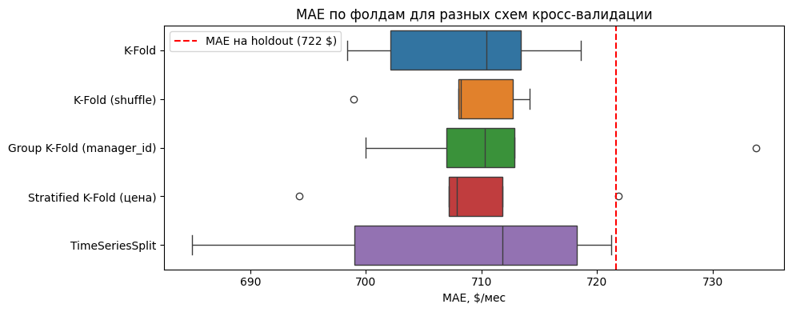
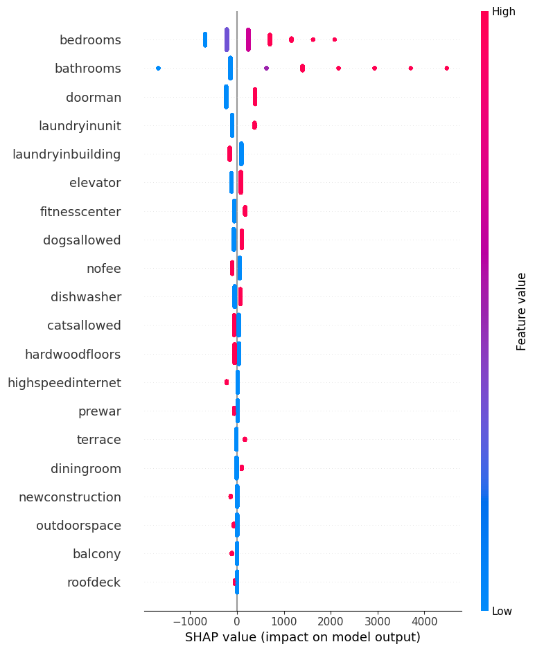

# Оценка качества модели: валидация, отбор признаков и подбор гиперпараметров

Как честно измерить качество модели и не допустить утечек данных. На задаче прогноза цены аренды квартир в Нью-Йорке реализованы с нуля схемы разбиения и кросс-валидации, методы отбора признаков и поиск гиперпараметров, всё сверено со `scikit-learn`. Главный эксперимент: какая схема кросс-валидации точнее всего предсказывает качество модели на будущих данных.

## Данные

[Two Sigma Connect: Rental Listing Inquiries](https://www.kaggle.com/competitions/two-sigma-connect-rental-listing-inquiries/data): около 49 тыс. объявлений об аренде с сайта RentHop за апрель-июнь 2016.

- **Таргет:** месячная цена аренды, \$.
- **Признаки (22):** число ванных и спален и 20 бинарных флагов для самых частых удобств (`elevator`, `doorman`, `dishwasher`, `nofee`, ...). Названия удобств приведены к одному регистру.
- **Для валидации:** дата публикации `created` (разбиение по времени) и `manager_id` (около 3.5 тыс. менеджеров, в среднем 14 объявлений на каждого).
- **Выбросы:** цены за пределами 1-го и 99-го перцентилей отброшены.

## Что сделано

- **Разбиения на train / valid / test:** случайное и по времени (out-of-time), детерминированные за счёт `random_state`.
- **Своя кросс-валидация:** K-Fold (с перемешиванием и без), Group K-Fold, Stratified K-Fold, TimeSeriesSplit. K-Fold и TimeSeriesSplit совпадают со sklearn по индексам, для остальных сравниваются распределения таргета в фолдах.
- **Сравнение схем CV:** последние 20% объявлений по дате откладываются как «будущее», на остальных данных модель оценивается каждой схемой, и оценки сравниваются с настоящей ошибкой на отложенной выборке.
- **Отбор признаков:** веса Lasso, пропуски + корреляция, свой permutation importance, SHAP. Сравнение по качеству, скорости и стабильности.
- **Подбор гиперпараметров ElasticNet:** свои Grid Search и Random Search (Random наследуется от Grid и меняет только генерацию кандидатов), sklearn, Optuna на валидационной выборке и на кросс-валидации. Test в подборе не участвует.

## Результаты

### Схемы кросс-валидации

Модель: линейная регрессия. Последние 20% объявлений по дате отложены, на них реальная MAE = **722 \$**.

| Схема | MAE на CV, \$ | Разброс по фолдам, \$ | Ошибка оценки, \$ |
|---|---|---|---|
| K-Fold | 709 | 7 | -13 |
| K-Fold (shuffle) | 708 | 5 | -13 |
| Group K-Fold (manager_id) | 713 | 11 | **-9** |
| Stratified K-Fold (цена) | 709 | 9 | -13 |
| TimeSeriesSplit | 707 | 13 | -15 |



### Отбор признаков

Lasso, разбиение по дате 60/20/20, метрики на test:

| Признаки | MAE, \$ | RMSE, \$ | R² | Время отбора, с |
|---|---|---|---|---|
| Все 22 | 721 | 1035 | 0.571 | - |
| Топ-10 по весам Lasso | 725 | 1041 | 0.566 | 0.002 |
| Топ-10 по корреляции | 734 | 1051 | 0.558 | 0.016 |
| Топ-10 по permutation importance | 725 | 1039 | 0.568 | 0.088 |
| Топ-10 по SHAP | 725 | 1040 | 0.568 | 0.208 |



### Подбор гиперпараметров

ElasticNet, подбор `alpha` и `l1_ratio` на train, метрики на отложенном test:

| Метод | alpha | l1_ratio | MAE, \$ | R² | Время, с |
|---|---|---|---|---|---|
| Grid Search (sklearn) | 0.0001 | 0.90 | 723.3 | 0.5838 | 10 |
| Grid Search (свой) | 0.0001 | 0.90 | 723.3 | 0.5838 | 36 |
| Random Search (sklearn) | 0.0003 | 0.47 | 725.4 | 0.5812 | 3 |
| Random Search (свой) | 0.0001 | 0.80 | 723.5 | 0.5836 | 21 |
| Optuna, valid | 0.0002 | 0.99 | 723.2 | 0.5839 | 32 |
| Optuna, 5-fold CV | 0.0001 | 0.96 | 723.2 | 0.5838 | 94 |

## Выводы

- Все схемы кросс-валидации немного занижают ошибку на будущих данных. Ближе всех Group K-Fold по менеджеру: если объявления одного менеджера есть и в train, и в test, оценка получается слишком оптимистичной. Для этой задачи я бы выбрал именно его. TimeSeriesSplit дал самый большой разброс, потому что первые фолды учатся на малой части данных.
- Половину признаков можно убрать почти без потери качества (+4 \$ к MAE). Веса Lasso, permutation importance и SHAP выбирают почти одно и то же, корреляция работает хуже всех, потому что смотрит на признаки по одному.
- Мой Grid Search находит те же параметры, что и sklearn, но медленнее, так как не распараллелен.
- Все методы подбора сходятся к минимальной регуляризации и одинаковому качеству: на 22 признаках и 48 тыс. объектов линейной модели нечего переобучать. Чтобы заметно улучшить прогноз, нужны новые признаки (координаты, текст, фото), а не подбор параметров.

## Как запустить

```bash
pip install -r requirements.txt
```

Скачайте `train.json` с Kaggle в папку `data/` и откройте `model_validation.ipynb`. Разбиения, кросс-валидация, отбор признаков и поиск гиперпараметров лежат в `validation.py`.

**Стек:** Python, NumPy, pandas, scikit-learn, SHAP, Optuna, matplotlib, seaborn.
